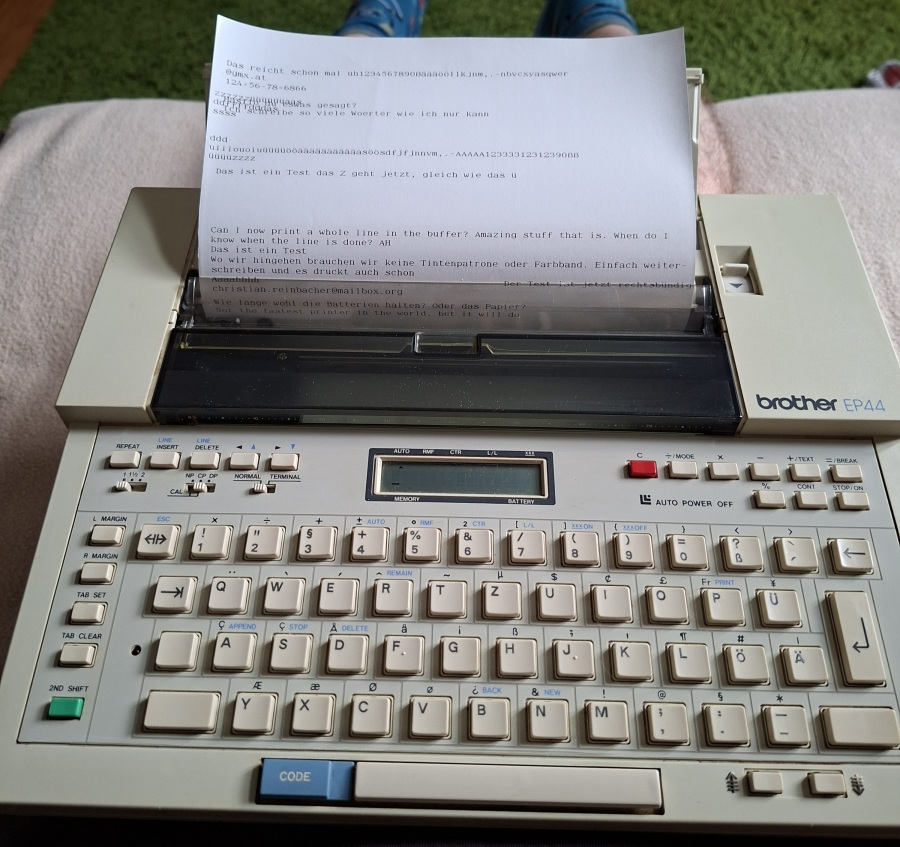
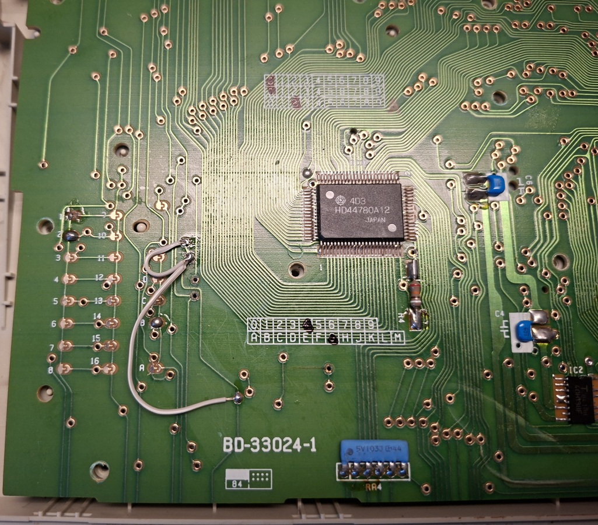
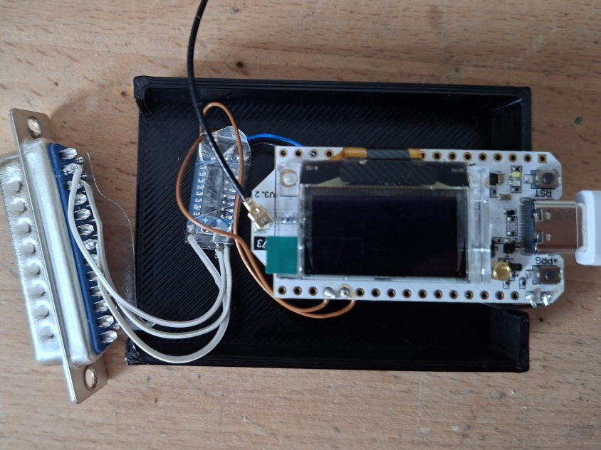
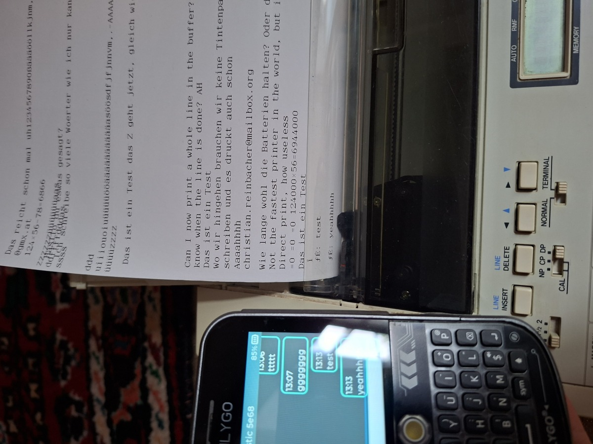
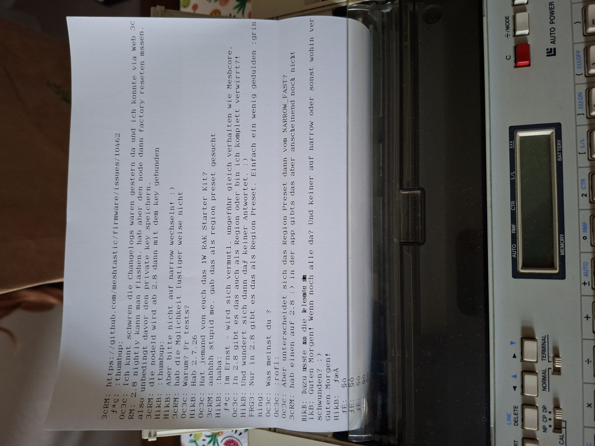
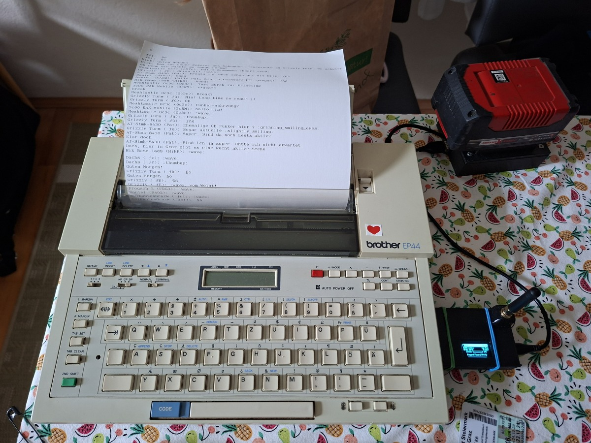

After [playing around with Meshtastic](/posts/meshtastic) for a while and mainly consuming work of others, I decided it was time to make something new, something unprecedented. Meshtastic supports a serial interface to send receive messages as simple text over serial and allows to send text to the first public channel. I saw people utilize this interface on [old computers](https://www.youtube.com/watch?v=_k508Uti_yE) from the DOS/Windows 95 era (or even [C64s](https://64jim64.blogspot.com/2025/09/meshtastic-64-meshtastic-radio-for.html)) to interface via the serial console. Nice, but what if you could do it with a typewriter?

My first plan was to get a cheap eletronic typewriter and add a serial interface by [tapping into the keyboard matrix with another micro controller](https://github.com/artillect/serial-typewriter). While looking for interesting typewriters, I stumbled upon a [Brother EP44](https://typewriterdatabase.com/1984-brother-ep44.5403.typewriter) which, as a party trick has a built-in Serial 25-pin interface to act as a terminal/printer. 



It was rather cheap since two keys didn't work. Well, it arrived and the reason for the non-working keys were rotten-away traces (possibly after a coffee spill). Nothing a little bit of solder can't fix:



[Meshtastic Serial module](https://meshtastic.org/docs/configuration/module/serial/) allows you to control a meshtastic device via UART. In `TEXTMSG` mode one can simply receive / send messages as raw text. Since the EP44 talks RS-232, I connected a Heltec V3 node's UART interface via a MAX-232 level shifter to a 25-pin Sub-D connector and put everything in a 3D printed case with lots of hot glue:



Setting the typewriter to 
- 300 Baud
- 8 data bits, no parity
- no error correction
- 8 bit codes

yes, you can send messages back and forth to other nodes!



There are a few issues with the usability straight away:
- Messages are being sent when you stop typing
- Android app only sends LF, the typewriter needs CR to, well, return the carriage
- Emojis are garbled up mess
- Every typed message goes to the first public channel

With meshtastic firmware being open source, I was able to fix all of the issues with a rather small [diff](/data/meshtyper.diff) that cleanly applies on top of current `2.8.2` firmware:
- Wait for Enter key before sending a message
- Replace emojis with their shortname (e.g. :smile: with `: smile :`)
- Replace LF with CR/LF
- Messages starting with `@<shortname> ` go to that node instead of Public channel.


```c
diff --git a/src/graphics/emotes.cpp b/src/graphics/emotes.cpp
index 51d82d610..fa86891ce 100644
--- a/src/graphics/emotes.cpp
+++ b/src/graphics/emotes.cpp
@@ -9,187 +9,176 @@ namespace graphics
 const Emote emotes[] = {
 #ifndef EXCLUDE_EMOJI
     // --- Thumbs ---
-    {"\U0001F44D", thumbup, thumbs_width, thumbs_height},   // 👍 Thumbs Up
-    {"\U0001F44E", thumbdown, thumbs_width, thumbs_height}, // 👎 Thumbs Down
+    {"\U0001F44D", "thumbup", thumbup, thumbs_width, thumbs_height},   // 👍 Thumbs Up
+    {"\U0001F44E", "thumbdown", thumbdown, thumbs_width, thumbs_height}, // 👎 Thumbs Down
 
     // --- Smileys (Multiple Unicode Aliases) ---
-    {"\U0001F60A", smiling_eyes, smiling_eyes_width, smiling_eyes_height},                // 😊 Smiling Eyes
-    {"\U0001F600", grinning, grinning_width, grinning_height},                            // 😀 Grinning Face
-    {"\U0001F603", grinning_big_eyes, grinning_big_eyes_width, grinning_big_eyes_height}, // 😃 Grinning Face with Big Eyes
-    {"\U0001F642", slightly_smiling, slightly_smiling_width, slightly_smiling_height},    // 🙂 Slightly Smiling Face
-    {"\U0001F609", winking_face, winking_face_width, winking_face_height},                // 😉 Winking Face
-    {"\U0001F601", grinning_smiling_eyes, grinning_smiling_eyes_width, grinning_smiling_eyes_height}, // 😁 Grinning Smiling Eyes
-    {"\U0001F60D", heart_eyes, heart_eyes_width, heart_eyes_height},                                  // 😍 Heart Eyes
-    {"\U0001F970", heart_smile, heart_smile_width, heart_smile_height}, // 🥰 Smiling Face with Hearts
-    {"\U0001F976", cold_face, cold_face_width, cold_face_height},       // 🥶 Cold Face
-    {"\U0001F629", weary_face, weary_face_width, weary_face_height},    // 😩 Weary Face
-    {"\U0001F62E", open_mouth, open_mouth_width, open_mouth_height},    // 😮 Open Mouth
+    {"\U0001F60A", "smiling_eyes", smiling_eyes, smiling_eyes_width, smiling_eyes_height},             // 😊 Smiling Eyes
+    {"\U0001F600", "grinning", grinning, grinning_width, grinning_height},                         // 😀 Grinning Face
+    {"\U0001F642", "slightly_smiling", slightly_smiling, slightly_smiling_width, slightly_smiling_height}, // 🙂 Slightly Smiling Face
+    {"\U0001F609", "winking_face", winking_face, winking_face_width, winking_face_height},             // 😉 Winking Face
+    {"\U0001F601", "grinning_smiling_eyes", grinning_smiling_eyes, grinning_smiling_eyes_width, grinning_smiling_eyes_height}, // 😁 Grinning Smiling Eyes
+    {"\U0001F60D", "heart_eyes", heart_eyes, heart_eyes_width, heart_eyes_height},                                  // 😍 Heart Eyes
+    {"\U0001F970", "heart_smile", heart_smile, heart_smile_width, heart_smile_height}, // 🥰 Smiling Face with Hearts
+    {"\U0001F976", "cold_face", cold_face, cold_face_width, cold_face_height},       // 🥶 Cold Face
+    {"\U0001F629", "weary_face", weary_face, weary_face_width, weary_face_height},    // 😩 Weary Face
+    {"\U0001F62E", "open_mouth", open_mouth, open_mouth_width, open_mouth_height},    // 😮 Open Mouth
 
     // --- Question/Alert ---
-    {"\u2753", question, question_width, question_height},                 // ❓ Question Mark
-    {"\u203C\uFE0F", bang, bang_width, bang_height},                       // ‼️ Double Exclamation Mark
-    {"\u26A0\uFE0F", caution, caution_width, caution_height},              // ⚠️ Warning Sign
-    {"\U0001F4F6", antenna_bars, antenna_bars_width, antenna_bars_height}, // 📶 Antenna Bars
+    {"\u2753", "question", question, question_width, question_height},    // ❓ Question Mark
+    {"\u203C\uFE0F", "bang", bang, bang_width, bang_height},          // ‼️ Double Exclamation Mark
+    {"\u26A0\uFE0F", "caution", caution, caution_width, caution_height}, // ⚠️ Warning Sign
+    {"\U0001F4F6", "antenna_bars", antenna_bars, antenna_bars_width, antenna_bars_height}, // 📶 Antenna Bars
 
     // --- Laughing Faces ---
-    {"\U0001F602", haha, haha_width, haha_height}, // 😂 Face with Tears of Joy
-    {"\U0001F923", rofl, rofl_width, rofl_height}, // 🤣 Rolling on the Floor Laughing
-    {"\U0001F606", smiling_closed_eyes, smiling_closed_eyes_width, smiling_closed_eyes_height}, // 😆 Smiling Closed Eyes
-    {"\U0001F605", haha, haha_width, haha_height},                                              // 😅 Smiling with Sweat
-    {"\U0001F604", grinning_smiling_eyes_2, grinning_smiling_eyes_2_width,
-     grinning_smiling_eyes_2_height},                                                        // 😄 Grinning Face with Smiling Eyes
-    {"\U0001F62D", loudly_crying_face, loudly_crying_face_width, loudly_crying_face_height}, // 😭 Loudly Crying Face
-    {"\U0001F92E", vomiting, vomiting_width, vomiting_height},                               // 🤮 Face Vomiting
-    {"\U0001F60E", cool, cool_width, cool_height},                                           // 😎 Smiling Face with Sunglasses
-    {"\U0001F634", sleeping_face, sleeping_face_width, sleeping_face_height},                // 😴 Sleeping Face
-    {"\U0001F440", eyes, eyes_width, eyes_height},                                           // 👀 Eyes
-    {"\U0001F441\uFE0F", eye, eye_width, eye_height},                                        // 👁️ Eye
+    {"\U0001F602", "haha", haha, haha_width, haha_height}, // 😂 Face with Tears of Joy
+    {"\U0001F923", "rofl", rofl, rofl_width, rofl_height}, // 🤣 Rolling on the Floor Laughing
+    {"\U0001F606", "smiling_closed_eyes", smiling_closed_eyes, smiling_closed_eyes_width, smiling_closed_eyes_height}, // 😆 Smiling Closed Eyes
+    {"\U0001F605", "haha", haha, haha_width, haha_height},                                              // 😅 Smiling with Sweat
+    {"\U0001F604", "grinning_smiling_eyes", grinning_smiling_eyes_2, grinning_smiling_eyes_2_width,
+     grinning_smiling_eyes_2_height}, // 😄 Grinning Face with Smiling Eyes
+    {"\U0001F62D", "loudly_crying_face", loudly_crying_face, loudly_crying_face_width, loudly_crying_face_height}, // 😭 Loudly Crying Face
+    {"\U0001F92E", "vomiting", vomiting, vomiting_width, vomiting_height},                               // 🤮 Face Vomiting
+    {"\U0001F60E", "cool", cool, cool_width, cool_height},                                           // 😎 Smiling Face with Sunglasses
+    {"\U0001F440", "eyes", eyes, eyes_width, eyes_height},                                           // 👀 Eyes
+    {"\U0001F441\uFE0F", "eye", eye, eye_width, eye_height},                                        // 👁️ Eye
+    {"\U0001F634", "sleeping_face", sleeping_face, sleeping_face_width, sleeping_face_height},                // 😴 Sleeping Face
 
     // --- Gestures and People ---
-    {"\U0001F44B", wave_icon, wave_icon_width, wave_icon_height},             // 👋 Waving Hand
-    {"\u270C\uFE0F", peace_sign, peace_sign_width, peace_sign_height},        // ✌️ Victory Hand
-    {"\U0001F596", vulcan_salute, vulcan_salute_width, vulcan_salute_height}, // 🖖 Vulcan Salute
-    {"\U0001F64F", praying, praying_width, praying_height},                   // 🙏 Praying Hands
-    {"\U0001F64C", raising_hands, raising_hands_width, raising_hands_height}, // 🙌 Raising Hands
-    {"\U0001F4AA", strong, strong_width, strong_height},                      // 💪 Flexed Biceps
-    {"\U0001F937", shrug, shrug_width, shrug_height},                         // 🤷 Person Shrugging
-    {"\U0001F920", cowboy, cowboy_width, cowboy_height},                      // 🤠 Cowboy Hat Face
-    {"\U0001F3A7", deadmau5, deadmau5_width, deadmau5_height},                // 🎧 Headphones
+    {"\U0001F44B", "wave", wave_icon, wave_icon_width, wave_icon_height},             // 👋 Waving Hand
+    {"\u270C\uFE0F", "victory", peace_sign, peace_sign_width, peace_sign_height},        // ✌️ Victory Hand
+    {"\U0001F596", "vulcan_salute", vulcan_salute, vulcan_salute_width, vulcan_salute_height}, // 🖖 Vulcan Salute
+    {"\U0001F64F", "praying", praying, praying_width, praying_height},                   // 🙏 Praying Hands
+    {"\U0001F4AA", "strong", strong, strong_width, strong_height},                      // 💪 Flexed Biceps
+    {"\U0001F937", "shrug", shrug, shrug_width, shrug_height},                         // 🤷 Person Shrugging
+    {"\U0001F920", "cowboy", cowboy, cowboy_width, cowboy_height},                      // 🤠 Cowboy Hat Face
+    {"\U0001F3A7", "deadmau5", deadmau5, deadmau5_width, deadmau5_height},                // 🎧 Headphones
 
     // --- Symbols ---
-    {"\u2714\uFE0F", check_mark, check_mark_width, check_mark_height},  // ✔️ Check Mark
-    {"\u2705", check_mark, check_mark_width, check_mark_height},        // ✅ Check Mark Button
-    {"\u2611\uFE0F", check_mark, check_mark_width, check_mark_height},  // ☑️ Check Box with Check
-    {"\U0001F3E0", house, house_width, house_height},                   // 🏠 House
-    {"\U0001F5FC", tower, tower_width, tower_height},                   // 🗼 Tokyo Tower
-    {"\U0001F4AF", one_hundred, one_hundred_width, one_hundred_height}, // 💯 Hundred Points Symbol
+    {"\u2714\uFE0F", "check_mark", check_mark, check_mark_width, check_mark_height}, // ✔️ Check Mark
+    {"\u2705", "check_mark", check_mark, check_mark_width, check_mark_height},       // ✅ Check Mark Button
+    {"\u2611\uFE0F", "check_mark", check_mark, check_mark_width, check_mark_height}, // ☑️ Check Box with Check
+    {"\U0001F3E0", "house", house, house_width, house_height},                  // 🏠 House
+    {"\U0001F5FC", "tower", tower, tower_width, tower_height},                   // 🗼 Tokyo Tower
+    {"\U0001F4AF", "one_hundred", one_hundred, one_hundred_width, one_hundred_height}, // 💯 Hundred Points Symbol
 
     // --- Weather ---
-    {"\u2600", sun, sun_width, sun_height},                                   // ☀ Sun (without variation selector)
-    {"\u2600\uFE0F", sun, sun_width, sun_height},                             // ☀️ Sun (with variation selector)
-    {"\U0001F327", rain, rain_width, rain_height},                            // 🌧 Cloud with Rain
-    {"\U0001F327\uFE0F", rain, rain_width, rain_height},                      // 🌧️ Cloud with Rain
-    {"\u2601\uFE0F", cloud, cloud_width, cloud_height},                       // ☁️ Cloud
-    {"\U0001F32B\uFE0F", fog, fog_width, fog_height},                         // 🌫️ Fog
-    {"\u2744\uFE0F", snowflake, snowflake_width, snowflake_height},           // ❄️ Snowflake
-    {"\U0001F4A7", drop, drop_width, drop_height},                            // 💧 Droplet
-    {"\U0001F321\uFE0F", thermometer, thermometer_width, thermometer_height}, // 🌡️ Thermometer
-    {"\U0001F326\uFE0F", sun_behind_raincloud, sun_behind_raincloud_width,
+    {"\u2600", "sun", sun, sun_width, sun_height},                                   // ☀ Sun (without variation selector)
+    {"\u2600\uFE0F", "sun", sun, sun_width, sun_height},                             // ☀️ Sun (with variation selector)
+    {"\U0001F327\uFE0F", "rain", rain, rain_width, rain_height},                      // 🌧️ Cloud with Rain
+    {"\u2601\uFE0F", "cloud", cloud, cloud_width, cloud_height},                       // ☁️ Cloud
+    {"\U0001F32B\uFE0F", "fog", fog, fog_width, fog_height},                         // 🌫️ Fog
+    {"\u2744\uFE0F", "snowflake", snowflake, snowflake_width, snowflake_height},           // ❄️ Snowflake
+    {"\U0001F4A7", "drop", drop, drop_width, drop_height},                            // 💧 Droplet
+    {"\U0001F321\uFE0F", "thermometer", thermometer, thermometer_width, thermometer_height}, // 🌡️ Thermometer
+    {"\U0001F326\uFE0F", "sun_behind_raincloud", sun_behind_raincloud, sun_behind_raincloud_width,
      sun_behind_raincloud_height},                                                        // 🌦️ Sun Behind Rain Cloud
-    {"\u26C5", sun_behind_cloud, sun_behind_cloud_width, sun_behind_cloud_height},        // ⛅ Sun Behind Cloud
-    {"\u26C5\uFE0F", sun_behind_cloud, sun_behind_cloud_width, sun_behind_cloud_height},  // ⛅️ Sun Behind Cloud
-    {"\U0001F328\uFE0F", cloud_with_snow, cloud_with_snow_width, cloud_with_snow_height}, // 🌨️ Cloud with Snow
-    {"\U0001F329\uFE0F", cloud_with_lightning, cloud_with_lightning_width,
+    {"\u26C5", "sun_behind_cloud", sun_behind_cloud, sun_behind_cloud_width, sun_behind_cloud_height},        // ⛅ Sun Behind Cloud
+    {"\u26C5\uFE0F", "sun_behind_cloud", sun_behind_cloud, sun_behind_cloud_width, sun_behind_cloud_height},  // ⛅️ Sun Behind Cloud
+    {"\U0001F328\uFE0F", "cloud_with_snow", cloud_with_snow, cloud_with_snow_width, cloud_with_snow_height}, // 🌨️ Cloud with Snow
+    {"\U0001F329\uFE0F", "cloud_with_lightning", cloud_with_lightning, cloud_with_lightning_width,
      cloud_with_lightning_height}, // 🌩️ Cloud with Lightning
-    {"\u26C8", cloud_with_lightning_rain, cloud_with_lightning_rain_width,
+    {"\u26C8", "cloud_with_lightning_rain", cloud_with_lightning_rain, cloud_with_lightning_rain_width,
      cloud_with_lightning_rain_height}, // ⛈ Cloud with Lightning and Rain
-    {"\u26C8\uFE0F", cloud_with_lightning_rain, cloud_with_lightning_rain_width,
+    {"\u26C8\uFE0F", "cloud_with_lightning_rain", cloud_with_lightning_rain, cloud_with_lightning_rain_width,
      cloud_with_lightning_rain_height},                                 // ⛈️ Cloud with Lightning and Rain
-    {"\U0001F32C\uFE0F", wind_face, wind_face_width, wind_face_height}, // 🌬️ Wind Face
-    {"\U0001F305", sunrise, sunrise_width, sunrise_height},             // 🌅 Sunrise
-    {"\U0001F304", sunrise, sunrise_width, sunrise_height},             // 🌄 Sunrise
-    {"\U0001F306", sunset, sunset_width, sunset_height},                // 🌆 Sunset
-    {"\U0001F307", sunset, sunset_width, sunset_height},                // 🌇 Sunset
+    {"\U0001F32C\uFE0F", "wind_face", wind_face, wind_face_width, wind_face_height}, // 🌬️ Wind Face
+    {"\U0001F305", "sunrise", sunrise, sunrise_width, sunrise_height},             // 🌅 Sunrise
+    {"\U0001F304", "sunrise", sunrise, sunrise_width, sunrise_height},             // 🌄 Sunrise
+    {"\U0001F306", "sunset", sunset, sunset_width, sunset_height},                // 🌆 Sunset
+    {"\U0001F307", "sunset", sunset, sunset_width, sunset_height},                // 🌇 Sunset
 
     // --- Moon Phases ---
-    {"\U0001F311", new_moon, new_moon_width, new_moon_height},                                     // 🌑 New Moon
-    {"\U0001F312", waxing_crescent_moon, waxing_crescent_moon_width, waxing_crescent_moon_height}, // 🌒 Waxing Crescent Moon
-    {"\U0001F313", first_quarter_moon, first_quarter_moon_width, first_quarter_moon_height},       // 🌓 First Quarter Moon
-    {"\U0001F314", waxing_gibbous_moon, waxing_gibbous_moon_width, waxing_gibbous_moon_height},    // 🌔 Waxing Gibbous Moon
-    {"\U0001F315", full_moon, full_moon_width, full_moon_height},                                  // 🌕 Full Moon
-    {"\U0001F316", waning_gibbous_moon, waning_gibbous_moon_width, waning_gibbous_moon_height},    // 🌖 Waning Gibbous Moon
-    {"\U0001F317", last_quarter_moon, last_quarter_moon_width, last_quarter_moon_height},          // 🌗 Last Quarter Moon
-    {"\U0001F318", waning_crescent_moon, waning_crescent_moon_width, waning_crescent_moon_height}, // 🌘 Waning Crescent Moon
-    {"\U0001F31B", first_quarter_moon_face, first_quarter_moon_face_width,
+    {"\U0001F311", "new_moon", new_moon, new_moon_width, new_moon_height},                                     // 🌑 New Moon
+    {"\U0001F312", "waxing_crescent_moon", waxing_crescent_moon, waxing_crescent_moon_width, waxing_crescent_moon_height}, // 🌒 Waxing Crescent Moon
+    {"\U0001F313", "first_quarter_moon", first_quarter_moon, first_quarter_moon_width, first_quarter_moon_height},       // 🌓 First Quarter Moon
+    {"\U0001F314", "waxing_gibbous_moon", waxing_gibbous_moon, waxing_gibbous_moon_width, waxing_gibbous_moon_height},    // 🌔 Waxing Gibbous Moon
+    {"\U0001F315", "full_moon", full_moon, full_moon_width, full_moon_height},                                  // 🌕 Full Moon
+    {"\U0001F316", "waning_gibbous_moon", waning_gibbous_moon, waning_gibbous_moon_width, waning_gibbous_moon_height},    // 🌖 Waning Gibbous Moon
+    {"\U0001F317", "last_quarter_moon", last_quarter_moon, last_quarter_moon_width, last_quarter_moon_height},          // 🌗 Last Quarter Moon
+    {"\U0001F318", "waning_crescent_moon", waning_crescent_moon, waning_crescent_moon_width, waning_crescent_moon_height}, // 🌘 Waning Crescent Moon
+    {"\U0001F31B", "first_quarter_moon", first_quarter_moon_face, first_quarter_moon_face_width,
      first_quarter_moon_face_height}, // 🌛 First Quarter Moon Face
 
     // --- Misc Faces ---
-    {"\U0001F608", devil, devil_width, devil_height}, // 😈 Smiling Face with Horns
-    {"\U0001F921", clown, clown_width, clown_height}, // 🤡 Clown Face
-    {"\U0001F916", robo, robo_width, robo_height},    // 🤖 Robot Face
-    {"\U0001F479", ogre, ogre_width, ogre_height},    // 👹 Ogre
+    {"\U0001F608", "devil", devil, devil_width, devil_height}, // 😈 Smiling Face with Horns
+    {"\U0001F921", "clown", clown, clown_width, clown_height}, // 🤡 Clown Face
+    {"\U0001F916", "robot", robo, robo_width, robo_height},    // 🤖 Robot Face
+    {"\U0001F479", "ogre", ogre, ogre_width, ogre_height},    // 👹 Ogre
 
     // --- Hearts (Multiple Unicode Aliases) ---
-    {"\u2665", heart, heart_width, heart_height},       // ♥ Black Heart Suit
-    {"\u2665\uFE0F", heart, heart_width, heart_height}, // ♥️ Black Heart Suit (emoji presentation)
-    {"\u2764\uFE0F", heart, heart_width, heart_height}, // ❤️ Red Heart
-    {"\U0001F9E1", heart, heart_width, heart_height},   // 🧡 Orange Heart
-    {"\U00002763", heart, heart_width, heart_height},   // ❣ Heart Exclamation
-    {"\U00002764", heart, heart_width, heart_height},   // ❤ Red Heart (legacy)
-    {"\U0001F495", heart, heart_width, heart_height},   // 💕 Two Hearts
-    {"\U0001F496", heart, heart_width, heart_height},   // 💖 Sparkling Heart
-    {"\U0001F497", heart, heart_width, heart_height},   // 💗 Growing Heart
-    {"\U0001F498", heart, heart_width, heart_height},   // 💘 Heart with Arrow
+    {"\u2665", "heart", heart, heart_width, heart_height},       // ♥ Black Heart Suit
+    {"\u2665\uFE0F", "heart", heart, heart_width, heart_height}, // ♥️ Black Heart Suit (emoji presentation)
+    {"\u2764\uFE0F", "heart", heart, heart_width, heart_height}, // ❤️ Red Heart
+    {"\U0001F9E1", "heart", heart, heart_width, heart_height},   // 🧡 Orange Heart
+    {"\U00002763", "heart", heart, heart_width, heart_height},   // ❣ Heart Exclamation
+    {"\U00002764", "heart", heart, heart_width, heart_height},   // ❤ Red Heart (legacy)
+    {"\U0001F495", "heart", heart, heart_width, heart_height},   // 💕 Two Hearts
+    {"\U0001F496", "heart", heart, heart_width, heart_height},   // 💖 Sparkling Heart
+    {"\U0001F497", "heart", heart, heart_width, heart_height},   // 💗 Growing Heart
+    {"\U0001F498", "heart", heart, heart_width, heart_height},   // 💘 Heart with Arrow
 
     // --- Objects ---
-    {"\U0001F4A9", poo, poo_width, poo_height},                        // 💩 Pile of Poo
-    {"\U0001F514", bell_icon, bell_icon_width, bell_icon_height},      // 🔔 Bell
-    {"\U0001F4CB", clipboard, clipboard_width, clipboard_height},      // 📋 Clipboard
-    {"\U0001F36A", cookie, cookie_width, cookie_height},               // 🍪 Cookie
-    {"\U0001F370", shortcake, shortcake_width, shortcake_height},      // 🍰 Shortcake
-    {"\U0001F351", peach, peach_width, peach_height},                  // 🍑 Peach
-    {"\U0001F983", turkey, turkey_width, turkey_height},               // 🦃 Turkey
-    {"\U0001F357", turkey_leg, turkey_leg_width, turkey_leg_height},   // 🍗 Poultry Leg
-    {"\U0001F525", fire, fire_width, fire_height},                     // 🔥 Fire
-    {"\u2728", sparkles, sparkles_width, sparkles_height},             // ✨ Sparkles
-    {"\U0001F573\uFE0F", hole, hole_width, hole_height},               // 🕳️ Hole
-    {"\U0001F3B3", bowling, bowling_width, bowling_height},            // 🎳 Bowling
-    {"\u2615", hot_beverage, hot_beverage_width, hot_beverage_height}, // ☕ Hot Beverage
-    {"\U0001F37A", beer, beer_width, beer_height},
-    {"\U0001F954", potato, potato_width, potato_height}, // 🥔 Potato
-    {"\U0001FAB5", wood, wood_width, wood_height},       // 🪵 Wood
+    {"\U0001F4A9", "poo", poo, poo_width, poo_height},                      // 💩 Pile of Poo
+    {"\U0001F514", "bell_icon", bell_icon, bell_icon_width, bell_icon_height},    // 🔔 Bell
+    {"\U0001F4CB", "clipboard", clipboard, clipboard_width, clipboard_height},    // 📋 Clipboard
+    {"\U0001F36A", "cookie", cookie, cookie_width, cookie_height},             // 🍪 Cookie
+    {"\U0001F370", "shortcake", shortcake, shortcake_width, shortcake_height},    // 🍰 Shortcake
+    {"\U0001F351", "peach", peach, peach_width, peach_height},                // 🍑 Peach
+    {"\U0001F983", "turkey", turkey, turkey_width, turkey_height},             // 🦃 Turkey
+    {"\U0001F357", "turkey_leg", turkey_leg, turkey_leg_width, turkey_leg_height}, // 🍗 Poultry Leg
+    {"\U0001F525", "fire", fire, fire_width, fire_height},                   // 🔥 Fire
+    {"\u2728", "sparkles", sparkles, sparkles_width, sparkles_height},           // ✨ Sparkles
+    {"\U0001F573\uFE0F", "hole", hole, hole_width, hole_height},             // 🕳️ Hole
+    {"\U0001F3B3", "bowling", bowling, bowling_width, bowling_height},          // 🎳 Bowling
+    {"\u2615", "hot_beverage", hot_beverage, hot_beverage_width, hot_beverage_height}, // ☕ Hot Beverage
+    {"\U0001F37A", "beer", beer, beer_width, beer_height},
+    {"\U0001F954", "potato", potato, potato_width, potato_height}, // 🥔 Potato
+    {"\U0001FAB5", "wood", wood, wood_width, wood_height},       // 🪵 Wood
 
     // --- Arrows ---
-    {"\u2193", downwards_arrow, downwards_arrow_width, downwards_arrow_height},          // ↓ Downwards Arrow
-    {"\u2193\uFE0E", downwards_arrow, downwards_arrow_width, downwards_arrow_height},    // ↓︎ Downwards Arrow (text)
-    {"\u2193\uFE0F", downwards_arrow, downwards_arrow_width, downwards_arrow_height},    // ↓️ Downwards Arrow (emoji)
-    {"\u2B07\uFE0F", downwards_arrow, downwards_arrow_width, downwards_arrow_height},    // ⬇️ Downwards Heavy Arrow (emoji)
-    {"\u2B07", downwards_arrow, downwards_arrow_width, downwards_arrow_height},          // ⬇ Downwards Heavy Arrow (text)
-    {"\u2199", south_west_arrow, south_west_arrow_width, south_west_arrow_height},       // ↙ South West Arrow
-    {"\u2199\uFE0E", south_west_arrow, south_west_arrow_width, south_west_arrow_height}, // ↙︎ South West Arrow (text)
-    {"\u2199\uFE0F", south_west_arrow, south_west_arrow_width, south_west_arrow_height}, // ↙️ South West Arrow (emoji)
-    {"\u2190", leftwards_arrow, leftwards_arrow_width, leftwards_arrow_height},          // ← Leftwards Arrow
-    {"\u2190\uFE0E", leftwards_arrow, leftwards_arrow_width, leftwards_arrow_height},    // ←︎ Leftwards Arrow (text)
-    {"\u2190\uFE0F", leftwards_arrow, leftwards_arrow_width, leftwards_arrow_height},    // ←️ Leftwards Arrow (emoji)
-    {"\u2B05\uFE0F", leftwards_arrow, leftwards_arrow_width, leftwards_arrow_height},    // ⬅️ Leftwards Heavy Arrow (emoji)
-    {"\u2B05", leftwards_arrow, leftwards_arrow_width, leftwards_arrow_height},          // ⬅ Leftwards Heavy Arrow (text)
-    {"\u2196", north_west_arrow, north_west_arrow_width, north_west_arrow_height},       // ↖ North West Arrow
-    {"\u2196\uFE0E", north_west_arrow, north_west_arrow_width, north_west_arrow_height}, // ↖︎ North West Arrow (text)
-    {"\u2196\uFE0F", north_west_arrow, north_west_arrow_width, north_west_arrow_height}, // ↖️ North West Arrow (emoji)
-    {"\u2191", upwards_arrow, upwards_arrow_width, upwards_arrow_height},                // ↑ Upwards Arrow
-    {"\u2191\uFE0E", upwards_arrow, upwards_arrow_width, upwards_arrow_height},          // ↑︎ Upwards Arrow (text)
-    {"\u2191\uFE0F", upwards_arrow, upwards_arrow_width, upwards_arrow_height},          // ↑️ Upwards Arrow (emoji)
-    {"\u2B06\uFE0F", upwards_arrow, upwards_arrow_width, upwards_arrow_height},          // ⬆️ Upwards Heavy Arrow (emoji)
-    {"\u2B06", upwards_arrow, upwards_arrow_width, upwards_arrow_height},                // ⬆ Upwards Heavy Arrow (text)
-    {"\u2197", north_east_arrow, north_east_arrow_width, north_east_arrow_height},       // ↗ North East Arrow
-    {"\u2197\uFE0E", north_east_arrow, north_east_arrow_width, north_east_arrow_height}, // ↗︎ North East Arrow (text)
-    {"\u2197\uFE0F", north_east_arrow, north_east_arrow_width, north_east_arrow_height}, // ↗️ North East Arrow (emoji)
-    {"\u2192", rightwards_arrow, rightwards_arrow_width, rightwards_arrow_height},       // → Rightwards Arrow
-    {"\u2192\uFE0E", rightwards_arrow, rightwards_arrow_width, rightwards_arrow_height}, // →︎ Rightwards Arrow (text)
-    {"\u2192\uFE0F", rightwards_arrow, rightwards_arrow_width, rightwards_arrow_height}, // →️ Rightwards Arrow (emoji)
-    {"\u27A1\uFE0F", rightwards_arrow, rightwards_arrow_width, rightwards_arrow_height}, // ➡️ Rightwards Heavy Arrow (emoji)
-    {"\u27A1", rightwards_arrow, rightwards_arrow_width, rightwards_arrow_height},       // ➡ Rightwards Heavy Arrow (text)
-    {"\u2198", south_east_arrow, south_east_arrow_width, south_east_arrow_height},       // ↘ South East Arrow
-    {"\u2198\uFE0E", south_east_arrow, south_east_arrow_width, south_east_arrow_height}, // ↘︎ South East Arrow (text)
-    {"\u2198\uFE0F", south_east_arrow, south_east_arrow_width, south_east_arrow_height}, // ↘️ South East Arrow (emoji)
+    {"\u2193", "downwards_arrow", downwards_arrow, downwards_arrow_width, downwards_arrow_height},          // ↓ Downwards Arrow
+    {"\u2193\uFE0E", "downwards_arrow", downwards_arrow, downwards_arrow_width, downwards_arrow_height},    // ↓︎ Downwards Arrow (text)
+    {"\u2193\uFE0F", "downwards_arrow", downwards_arrow, downwards_arrow_width, downwards_arrow_height},    // ↓️ Downwards Arrow (emoji)
+    {"\u2199", "south_west_arrow", south_west_arrow, south_west_arrow_width, south_west_arrow_height},       // ↙ South West Arrow
+    {"\u2199\uFE0E", "south_west_arrow", south_west_arrow, south_west_arrow_width, south_west_arrow_height}, // ↙︎ South West Arrow (text)
+    {"\u2199\uFE0F", "south_west_arrow", south_west_arrow, south_west_arrow_width, south_west_arrow_height}, // ↙️ South West Arrow (emoji)
+    {"\u2190", "leftwards_arrow", leftwards_arrow, leftwards_arrow_width, leftwards_arrow_height},          // ← Leftwards Arrow
+    {"\u2190\uFE0E", "leftwards_arrow", leftwards_arrow, leftwards_arrow_width, leftwards_arrow_height},    // ←︎ Leftwards Arrow (text)
+    {"\u2190\uFE0F", "leftwards_arrow", leftwards_arrow, leftwards_arrow_width, leftwards_arrow_height},    // ←️ Leftwards Arrow (emoji)
+    {"\u2196", "north_west_arrow", north_west_arrow, north_west_arrow_width, north_west_arrow_height},       // ↖ North West Arrow
+    {"\u2196\uFE0E", "north_west_arrow", north_west_arrow, north_west_arrow_width, north_west_arrow_height}, // ↖︎ North West Arrow (text)
+    {"\u2196\uFE0F", "north_west_arrow", north_west_arrow, north_west_arrow_width, north_west_arrow_height}, // ↖️ North West Arrow (emoji)
+    {"\u2191", "upwards_arrow", upwards_arrow, upwards_arrow_width, upwards_arrow_height},                // ↑ Upwards Arrow
+    {"\u2191\uFE0E", "upwards_arrow", upwards_arrow, upwards_arrow_width, upwards_arrow_height},          // ↑︎ Upwards Arrow (text)
+    {"\u2191\uFE0F", "upwards_arrow", upwards_arrow, upwards_arrow_width, upwards_arrow_height},          // ↑️ Upwards Arrow (emoji)
+    {"\u2197", "north_east_arrow", north_east_arrow, north_east_arrow_width, north_east_arrow_height},       // ↗ North East Arrow
+    {"\u2197\uFE0E", "north_east_arrow", north_east_arrow, north_east_arrow_width, north_east_arrow_height}, // ↗︎ North East Arrow (text)
+    {"\u2197\uFE0F", "north_east_arrow", north_east_arrow, north_east_arrow_width, north_east_arrow_height}, // ↗️ North East Arrow (emoji)
+    {"\u2192", "rightwards_arrow", rightwards_arrow, rightwards_arrow_width, rightwards_arrow_height},       // → Rightwards Arrow
+    {"\u2192\uFE0E", "rightwards_arrow", rightwards_arrow, rightwards_arrow_width, rightwards_arrow_height}, // →︎ Rightwards Arrow (text)
+    {"\u2192\uFE0F", "rightwards_arrow", rightwards_arrow, rightwards_arrow_width, rightwards_arrow_height}, // →️ Rightwards Arrow (emoji)
+    {"\u2198", "south_east_arrow", south_east_arrow, south_east_arrow_width, south_east_arrow_height},       // ↘ South East Arrow
+    {"\u2198\uFE0E", "south_east_arrow", south_east_arrow, south_east_arrow_width, south_east_arrow_height}, // ↘︎ South East Arrow (text)
+    {"\u2198\uFE0F", "south_east_arrow", south_east_arrow, south_east_arrow_width, south_east_arrow_height}, // ↘️ South East Arrow (emoji)
 
     // --- Halloween ---
-    {"\U0001F383", jack_o_lantern, jack_o_lantern_width, jack_o_lantern_height}, // 🎃 Jack-O-Lantern
-    {"\U0001F47B", ghost, ghost_width, ghost_height},                            // 👻 Ghost
-    {"\U0001F480", skull, skull_width, skull_height},                            // 💀 Skull
+    {"\U0001F383", "jack_o_lantern", jack_o_lantern, jack_o_lantern_width, jack_o_lantern_height}, // 🎃 Jack-O-Lantern
+    {"\U0001F47B", "ghost", ghost, ghost_width, ghost_height},                            // 👻 Ghost
+    {"\U0001F480", "skull", skull, skull_width, skull_height},                             // 💀 Skull
 
     // --- Holidays ---
-    {"\U0001F384", christmas_tree, christmas_tree_width, christmas_tree_height}, // 🎄 Christmas Tree
-    {"\U0001F381", wrapped_gift, wrapped_gift_width, wrapped_gift_height},       // 🎁 Wrapped Gift
-    {"\U0001F54E", menorah, menorah_width, menorah_height},                      // 🕎 Menorah
-    {"\u271D\uFE0F", latin_cross, latin_cross_width, latin_cross_height},        // ✝️ Latin Cross
-    {"\u2721\uFE0F", star_of_david, star_of_david_width, star_of_david_height},  // ✡️ Star of David
-    {"\u26C4", snow_man, snow_man_width, snow_man_height},                       // ⛄ Snowman
-    {"\u2603\uFE0F", snow_man, snow_man_width, snow_man_height},                 // ☃️ Snowman
+    {"\U0001F384", "christmas_tree", christmas_tree, christmas_tree_width, christmas_tree_height}, // 🎄 Christmas Tree
+    {"\U0001F381", "wrapped_gift", wrapped_gift, wrapped_gift_width, wrapped_gift_height},       // 🎁 Wrapped Gift
+    {"\U0001F54E", "menorah", menorah, menorah_width, menorah_height},                      // 🕎 Menorah
+    {"\u271D\uFE0F", "latin_cross", latin_cross, latin_cross_width, latin_cross_height},        // ✝️ Latin Cross
+    {"\u2721\uFE0F", "star_of_david", star_of_david, star_of_david_width, star_of_david_height},  // ✡️ Star of David
+    {"\u26C4", "snow_man", snow_man, snow_man_width, snow_man_height},                       // ⛄ Snowman
+    {"\u2603\uFE0F", "snow_man", snow_man, snow_man_width, snow_man_height},                 // ☃️ Snowman
 
     // --- Misc ---
-    {"\U0001F4A8", dashing_away, dashing_away_width, dashing_away_height}, // 💨 Dashing Away
-    {"\U0001F4CD", pushpin, pushpin_width, pushpin_height}                 // 📍 Pushpin
+    {"\U0001F4A8", "dashing_away", dashing_away, dashing_away_width, dashing_away_height}, // 💨 Dashing Away
+    {"\U0001F4CD", "pushpin", pushpin, pushpin_width, pushpin_height}                 // 📍 Pushpin
 #endif
 };
 
diff --git a/src/graphics/emotes.h b/src/graphics/emotes.h
index cb00f5d0e..7f99ea702 100644
--- a/src/graphics/emotes.h
+++ b/src/graphics/emotes.h
@@ -7,6 +7,7 @@ namespace graphics
 // === Emote List ===
 struct Emote {
     const char *label;
+    const char * name;
     const unsigned char *bitmap;
     int width;
     int height;
diff --git a/src/modules/SerialModule.cpp b/src/modules/SerialModule.cpp
index 00686bfae..e4771bb21 100644
--- a/src/modules/SerialModule.cpp
+++ b/src/modules/SerialModule.cpp
@@ -7,6 +7,8 @@
 #include "configuration.h"
 #include "gps/RTC.h"
 #include "meshUtils.h"
+#include "graphics/EmoteRenderer.h"
+#include "graphics/emotes.h"
 #include <Arduino.h>
 #include <Throttle.h>
 
@@ -110,7 +112,7 @@ SerialModule::SerialModule() : StreamAPI(&SERIAL_PRINT_OBJECT), concurrency::OST
 static Print *serialPrint = &SERIAL_PRINT_OBJECT;
 
 char serialBytes[512];
-size_t serialPayloadSize;
+size_t serialPayloadSize = 0;
 
 SerialModuleRadio::SerialModuleRadio() : SinglePortModule("SerialModuleRadio", meshtastic_PortNum_SERIAL_APP)
 {
@@ -291,8 +293,15 @@ int32_t SerialModule::runOnce()
 #else
                 HardwareSerial *serialInstance = &Serial1;
 #endif
-                while (serialInstance->available()) {
-                    serialPayloadSize = serialInstance->readBytes(serialBytes, meshtastic_Constants_DATA_PAYLOAD_LEN);
+                while (serialInstance->available()) { // wait for CR and collect bytes, then send
+                    size_t newSerialPayloadSize = serialInstance->readBytes(
+                        &serialBytes[serialPayloadSize],
+                        meshtastic_Constants_DATA_PAYLOAD_LEN - serialPayloadSize);
+                    serialPayloadSize += newSerialPayloadSize;
+                    // Echo new text back
+                    for (int i=serialPayloadSize - newSerialPayloadSize; i<serialPayloadSize; i++) {
+                        serialPrint->printf("%c", serialBytes[i]);
+                    }
 #endif
                     serialModuleRadio->sendPayload();
                 }
@@ -341,10 +350,36 @@ void SerialModule::sendTelemetry(meshtastic_Telemetry m)
  */
 void SerialModuleRadio::sendPayload(NodeNum dest, bool wantReplies)
 {
+    if (
+        serialPayloadSize > 0 && 
+        serialBytes[serialPayloadSize - 1] != '\n' && 
+        serialPayloadSize != meshtastic_Constants_DATA_PAYLOAD_LEN) {
+        return;
+    }
     const meshtastic_Channel *ch = (boundChannel != NULL) ? &channels.getByName(boundChannel) : NULL;
     meshtastic_MeshPacket *p = allocDataPacket();
     if (!p)
         return;
+    int string_start = 0;
+    if (serialBytes[0] == '@') {
+        // If the first word is a known short name, send the message there
+        char short_name[5];
+        short_name[4]=0;
+        for (size_t i=0; i<4; i++) {
+            short_name[i] = serialBytes[i+1];
+            if (i>serialPayloadSize || serialBytes[i+2] == ' ' || serialBytes[i+2] == '\n') {
+                short_name[i+1] = 0;
+                string_start = std::min(i+3, serialPayloadSize - 1);
+                break;
+            }
+        }
+        // Search in NodeDB
+        for (int i = 0; i < nodeDB->numMeshNodes; i++) {
+            if (!strncmp(nodeDB->meshNodes->at(i).short_name, short_name, 5)) {
+                dest = nodeDB->meshNodes->at(i).num;
+            }
+        }
+    }
     p->to = dest;
     if (ch != NULL) {
         p->channel = ch->index;
@@ -353,10 +388,12 @@ void SerialModuleRadio::sendPayload(NodeNum dest, bool wantReplies)
 
     p->want_ack = ACK;
 
-    p->decoded.payload.size = serialPayloadSize; // You must specify how many bytes are in the reply
-    memcpy(p->decoded.payload.bytes, serialBytes, p->decoded.payload.size);
+    p->decoded.payload.size = serialPayloadSize - 2 - string_start; // Leave out the last CR/LF
+    memcpy(p->decoded.payload.bytes, &serialBytes[string_start], p->decoded.payload.size);
 
     service->sendToMesh(p);
+    // reset counter
+    serialPayloadSize = 0;
 }
 
 /**
@@ -401,9 +438,25 @@ ProcessMessage SerialModuleRadio::handleReceived(const meshtastic_MeshPacket &mp
                 serialPrint->write(p.payload.bytes, p.payload.size);
             } else if (moduleConfig.serial.mode == meshtastic_ModuleConfig_SerialConfig_Serial_Mode_TEXTMSG) {
                 meshtastic_NodeInfoLite *node = nodeDB->getMeshNode(getFrom(&mp));
-                const char *sender = nodeInfoLiteHasUser(node) ? node->short_name : "???";
-                serialPrint->println();
-                serialPrint->printf("%s: %.*s", sender, (int)p.payload.size, p.payload.bytes);
+                if(strlen(node->long_name) > 0) {
+                    serialPrint->printf("%s (%s): ", node->long_name, node->short_name);
+                }
+                for(int i=0; i<p.payload.size;) {
+                    if((i==0 && p.payload.bytes[i] == '\n') ||
+                       (i>0 && p.payload.bytes[i] == '\n' && p.payload.bytes[i-1] != '\r')) {
+                        serialPrint->printf("\r");
+                    }
+                    size_t matchLen = 0;
+                    const graphics::Emote *matched = graphics::EmoteRenderer::findEmoteAt(
+                        (const char*)(p.payload.bytes),
+                        p.payload.size, i, matchLen);
+                    if (matched) {
+                        serialPrint->printf(":%s:", matched->name);
+                        i += matchLen;
+                    } else {
+                        serialPrint->printf("%c", p.payload.bytes[i++]);
+                    }
+                }
                 serialPrint->println();
             } else if ((moduleConfig.serial.mode == meshtastic_ModuleConfig_SerialConfig_Serial_Mode_NMEA ||
                         moduleConfig.serial.mode == meshtastic_ModuleConfig_SerialConfig_Serial_Mode_CALTOPO) &&
```



So this is what a few hours listening on the local mesh look like:



I've also added a power supply (6V center negative for the EP44, 5V for the node) from an Einhell drill battery, which is good for 2 days of runtime:

