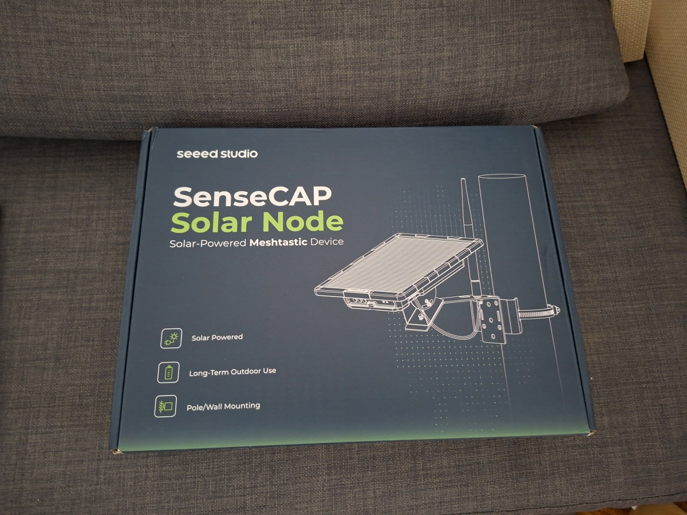
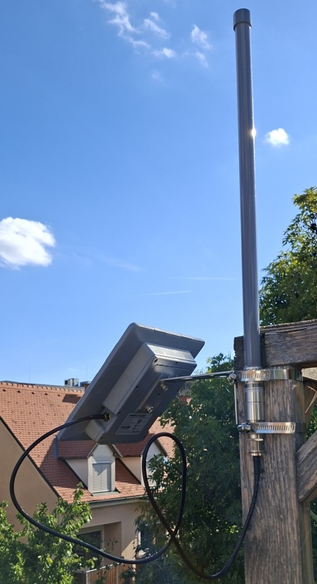

In March 2026 I watched an excellent documentary about people using off-grid communication on Arte TV:


While the documentary focuses a lot on motivation for using communication networks outside the reach of governments or without relying on existing infrastructure I was mainly interested in the underlying technology [LoRa](https://en.wikipedia.org/wiki/LoRa). The documentary features [Meshtastic](https://meshtastic.org/) prominently, so I read the project documentation and within a day ordered two nodes to start tinkering with.

## Nodes

I chose [Seeed Studio Wio Tracker L1s](https://meshtastic.org/docs/hardware/devices/seeed-studio/wio-series/tracker-l1/), in particular the version without case and eInk display. I combined them with old Nokia batteries and 3D-printed cases, switched them on and - to my surprise - discovered a very active mesh in the area with about 60-100 active nodes.

Participating in the mesh turned out to be harder than anticipated. The small antennas on the purchased nodes was enough to listen in on the public chat and send messages back and forth, but not sending to other neighboring nodes. Instead of giving up on Meshtastic, I decided to throw more money at the problem, purchasing a solar node to put on our rooftop:

a [Seeed Studio SenseCAP Solar Node](https://meshtastic.org/docs/hardware/devices/seeed-studio/sensecap/solar-node/). Ahh, much better!

In the meantime, I got a few more nodes to play with tracking and sending of telemetry and sensor data, all in all the setup is working well for more than half a year now. Even with only a few hours of sunshine now, the solar node's battery rarely falls below 90%.

## Presentation at Hackmas 2026

In August 2026 I went to the [Hackmas](https://hack-mas.at) hacker camp, determined to give my first talk at a CCC venue. I prepared a presentation about everything I knew and liked about meshtastic by that time and here it is:


The slides can be found [here](/data/meshtastic.pdf).

## Usecase

I get ask about the usecase of such an off-grid communication network, and I have to admit, I don't really know. For now, I enjoy tinkering with software and hardware, getting to meet interesting people in random chats as well as knowing there is a fallback communication network if need ever arises.