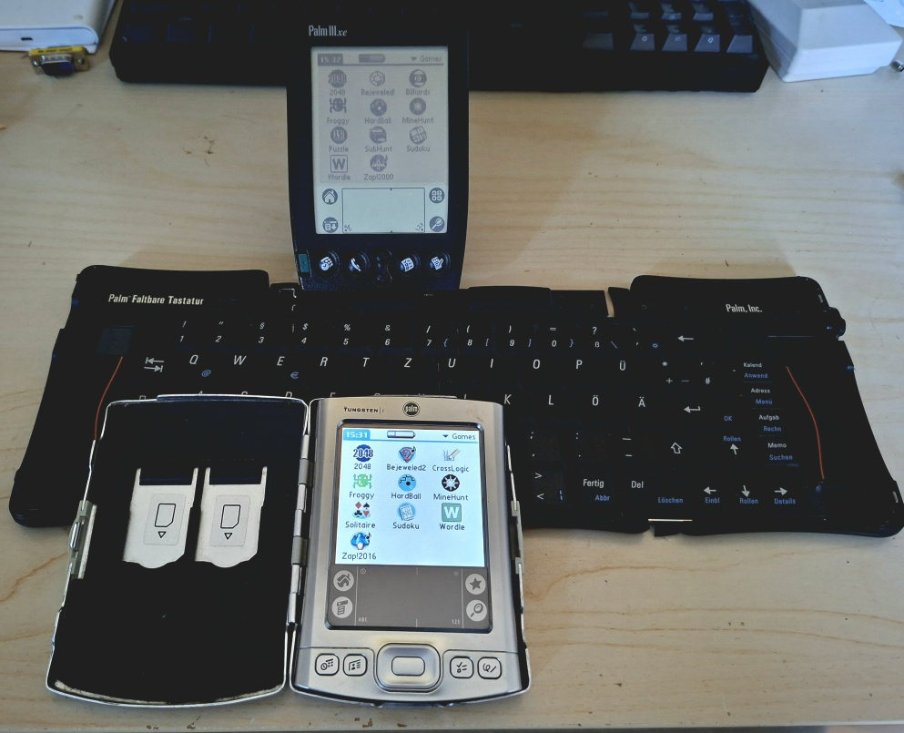

I recently go myself a *Palm IIIxe* to replace my Remarkable Move for [daily journaling](/posts/palm-worklog). Well, actually I have two Palms now, a *Tungsten E* needed rescuing as well:

Anyhow. Getting software on to them and backups off again turns out to be relatively easy. The *Palm IIIxe* has a cradle with a serial port, the *Tungsten E* a mini-USB connector. While the former needs a USB-serial converter, the latter can be connected directly. My setup:
- Microsoft Surface Go running Fedora 45
- [Digitus USB-to-Serial adapter](https://products.digitus.com/en/Cables-and-Peripherals/Computer-Accessories/IO-Cards/USB-to-serial-adapter.html)
- [J-Pilot](https://www.jpilot.org)
- [Palm Calendar Sync](https://github.com/guruthree/palm-calendar-sync2)

## Setup
The USB-serial converter works out of the box and generates a `/dev/ttyUSB0` device. The *Tungsten E* did not. It needed a manual
~~~
sudo modprove visor
~~~
and a press of the HotSync button to generate `/dev/ttyUSB0` and `/dev/ttyUSB1`, only the latter one being usable.

## Sync
J-Pilot either has a graphical user interface which mimics the Palm Desktop software the devices originally came with, or a CLI to interact with basic functionality. Generating a backup is as easy as
~~~
jpilot-sync -p /dev/ttyUSB1
~~~

## Installing files
This can either be done via the GUI or by generating a file `~/.jpilot/jpilot.install` which contains one path to a `.prc` or `.pdb` file per line, then performing a sync as above. This can be useful as a Makefile target when implementing your own software.

## Calendar Sync
If you are like me and not yet ready to give up the modern amenities like having a calendar synced across devices, [Palm Calendar Sync](https://github.com/guruthree/palm-calendar-sync2) is what you want. The program is able to download any `.ics` file, parse it and write it in a format the Palm understands. My example config looks like:
~~~
URI="https://raw.githubusercontent.com/libical/libical/master/test-data/recur.txt" # libical recurrence test data, actual data redacted

PORT="/dev/ttyUSB0"
DOHOTSYNC=true
READONLY=false
SECURE=true
TIMEZONE="Europe/Vienna"
OVERWRITE=true
DOALARMS=false
~~~

I set `OVERWRITE=true` since I don't plan to enter new appointments on the Palm itself, so it always overwrites existing calendars on the Palm.

This makes those devices usable calendars, at least until [Palm Day](https://palmdb.net/about/palm-day).