Between 2014 and 2016 I produced an anstonishing amount of watchfaces for Pebble smartwatches (which even earned me the inofficial "rockstar developer" badge). I'm glad to see them back now, so have here a list of what I made.

# Apps

## Drink Counter

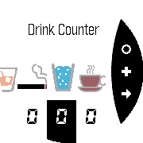 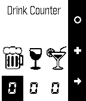 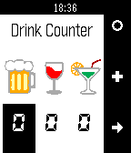

Drink Counter allows you to keep track of your alcohol, water and cigarette consumption. It even estimates the blood alcohol level based on your gender, weight and number of drinks. NEW: Timeline support (logs your drinks to timeline).

[App store link](https://apps.repebble.com/drink-counter_554b93a25fa04f7f3f000058)
[Source link](https://github.com/reini1305/drinkcounter)

## Alarms++

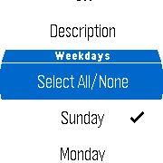 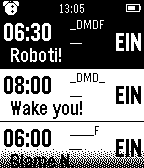 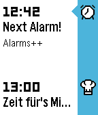

With Alarms++ you can flexibly schedule up to 16 (32 on Pebble Time) alarms on specific weekdays. You could set alarms for your work days and another one for the weekend. You can add descriptions to the alarms which will be shown when the alarm goes off. With snooze function, localization and 12h/24h support. NEW: Timeline support!

[App store link](https://apps.repebble.com/alarms_54551598997cdfddaa000043)
[Source link](https://github.com/reini1305/alarmsplusplus)

## QR Generator

  

Displays your business card or any string as QR code on your watch! Simply set the string on the configuration page on the phone. The QR code is generated on your phone and sent to the watch. No companion app needed! Works without internet connection.

[App store link](https://apps.repebble.com/qr-generator_535e84d0af59179a46000088)
[Source link](https://github.com/reini1305/qrgenerator)

## Multi Timer ++

This is a remix of the Multi-Timer app of Matthew Tole with a few added features:
- Set descriptions for each timer
- Dictate descriptions
- Timeline Support (for the next timer)
- AppGlance Support (for the next timer)

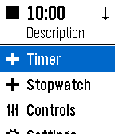

[App store link](https://apps.repebble.com/multi-timer_5814a5a946041f90f4000161)

# Watchfaces

## Crazy Eyes

  

Crazy Eyes shows you the time in a unique way. The left eye represents the hour, the right eye the current minute. The eyebrows are configurable and encode the battery level of your pebble. On a bluetooth disconnect, the eyebrows become narrower. Background color changes randomly every minute. Optionally, the face can be completed with a mouth that shows the day of the week.

[App store link](https://apps.repebble.com/crazy-eyes_553cecb534add0de92000072)
[Source link](https://github.com/reini1305/crazy_eyes)

## AMazeR

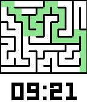 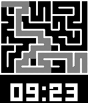 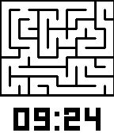

AMazeR creates a new maze every minute. You can puzzle yourself or see the solution when you flick your watch. Two different themes (light and dark) can be configured as well as a vibration on bluetooth disconnect.

[App store link](https://apps.repebble.com/amazer_57f9e4e41fd66b82d300005a)
[Source link](https://github.com/reini1305/mazegen)

## Heart Beat

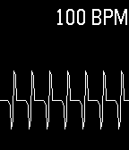

Heart Beat uses the new Heart Rate Sensor in Pebble 2 to provide a pretty visualization, well, of your heart beat. HR is sampled every 5 seconds to not destroy battery life.

[App store link](https://apps.repebble.com/heart-beat_57d52323ffca49333f00021e)

## Fireworks

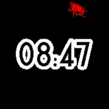  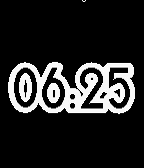

Fireworks on your Pebble every minute! Shake to firework! (Both configurable of course).

[App store link](https://apps.repebble.com/fireworks_5588e2fdef446dab8f000061)
[Source link](https://github.com/reini1305/fireworks)

## Gradient Weather

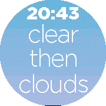 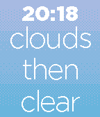 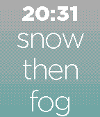

Minimal watchface that shows you the current condition and 3h forecast in textual form. The background gradient changes according to the conditions. Inspired by the ustwo Smart Watch Faces (especially Episode) for Android Wear.

[Source link](https://github.com/reini1305/gradient-weather)

## Digilog

  

Simple combination of analog and digital watchface. The hours are shown as number in the background whereas the minutes are shown in an analog style. You can freely set the colors with a live preview on your phone! Design credits go to /u/thenextbigthing2.

[App store link](https://apps.repebble.com/digilog_55997be0a3e668a6ea000063)
[Source link](https://github.com/reini1305/digilog)

## Fun with Flags

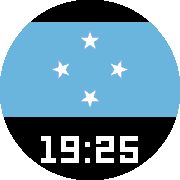  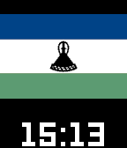

Learn some new flags on the go! Every minute a new flag is shown. if you flick your wrist, your watch will tell you which country the flag belongs to.

[App store link](https://apps.repebble.com/fun-with-flags_5659b0dc36f882e860000055)
[Source link](https://github.com/reini1305/funwithflags)

## Time Less

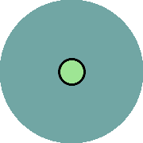  

Do you feel stressed when looking at your watch? With this watchface this won't happen anymore. It shows the time using simple colors, one color displacing the other while the hour passes by.

[App store link](https://apps.repebble.com/time-less_5788ce3884accc5dac000009)
[Source link](https://github.com/reini1305/stressless)

## Corpus Clock

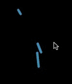  

This watchface resembles the animations to be found at the "corpus clock" at the Corpus Christi College in Cambridge. You can set the amount of animation in the settings.

[App store link](https://apps.repebble.com/corpus-clock_5810cbe3836d3cb4e80001c5)
[Source link](https://github.com/reini1305/corpus-clock)

## Channel Split

Channel Split is a simple, yet super customizable watchface with subtle animations that is reminiscent of the early days of anaglyphic 3D experiences.

[App store link](https://apps.repebble.com/channel-split_581628a2204470de17000229)

## Analog-ish

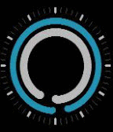

Combining sci-fi inspired simplicity with traditional timepieces, "analog-ish" is a carefully crafted throwback to the future for daily use.

[App store link](https://apps.repebble.com/analog-ish_581f405b1c08888f0300029c)

## Clean Cut

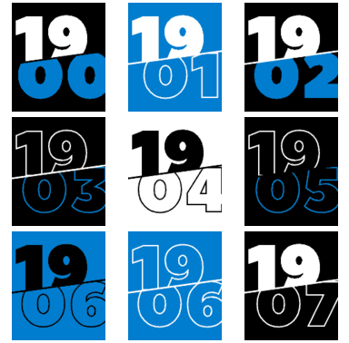

Made due to a reddit request from /u/stegosaurusflex1 (who also gets the design credits). You can freely select the colors of hour, minute, background and seperator. The font is called "Peace Sans", made by Sergey Ryadovoy.

[App store link](https://apps.repebble.com/clean-cut_5803cc5cc98866548c000141)
[Source link](https://github.com/reini1305/cutting_edge)

## Strider HR

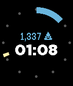 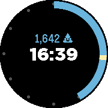 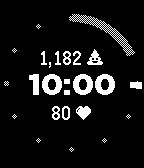

This is a clone of the Pebble watchface Strider, based on the original source code. This modified version adds support for Pebble 2 and a few layout tweaks compared to the original

[App store link](https://apps.repebble.com/striderhr_5800edb0d43cb3a62e000001)
[Source link](https://github.com/reini1305/strider-watchface)