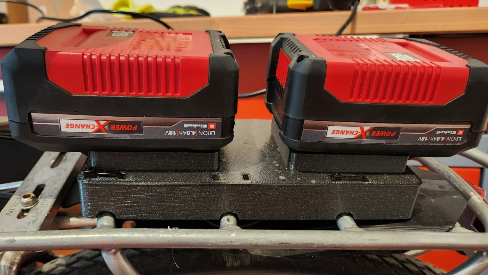
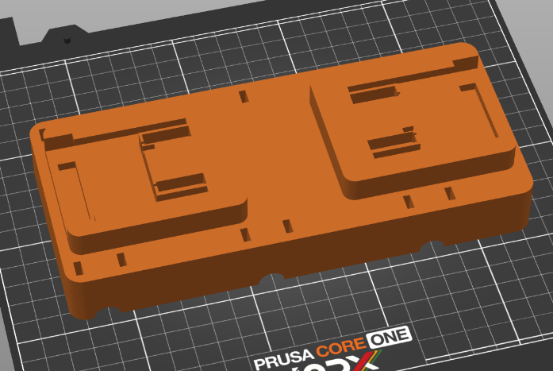
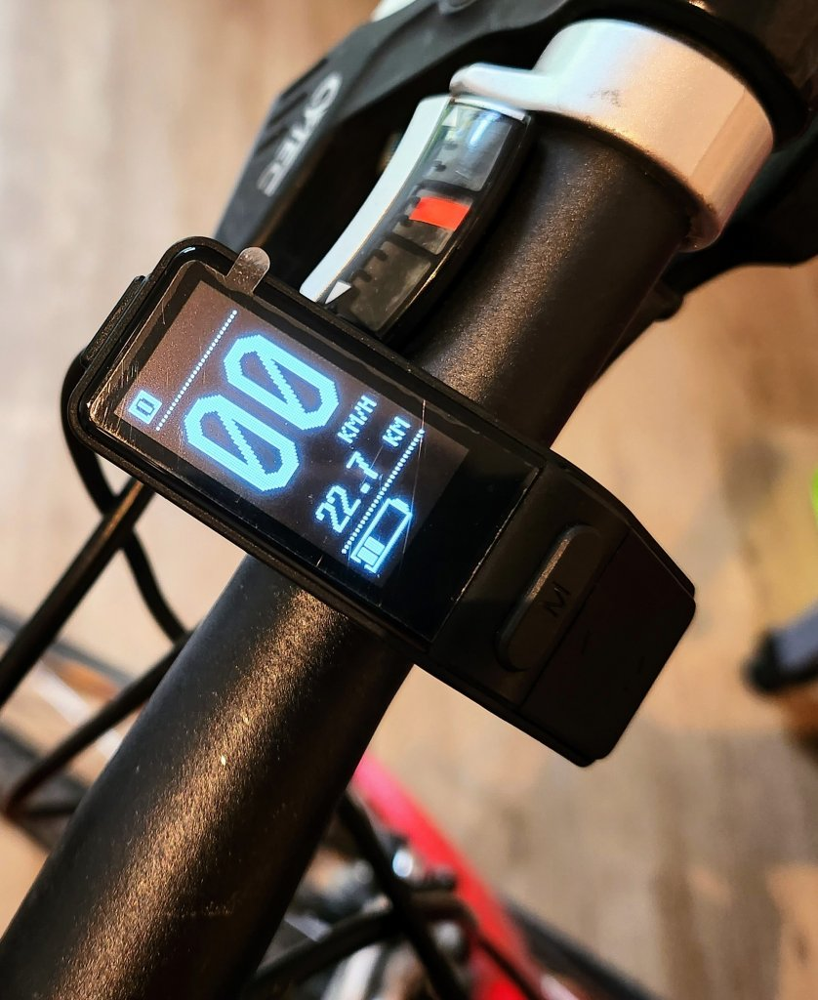
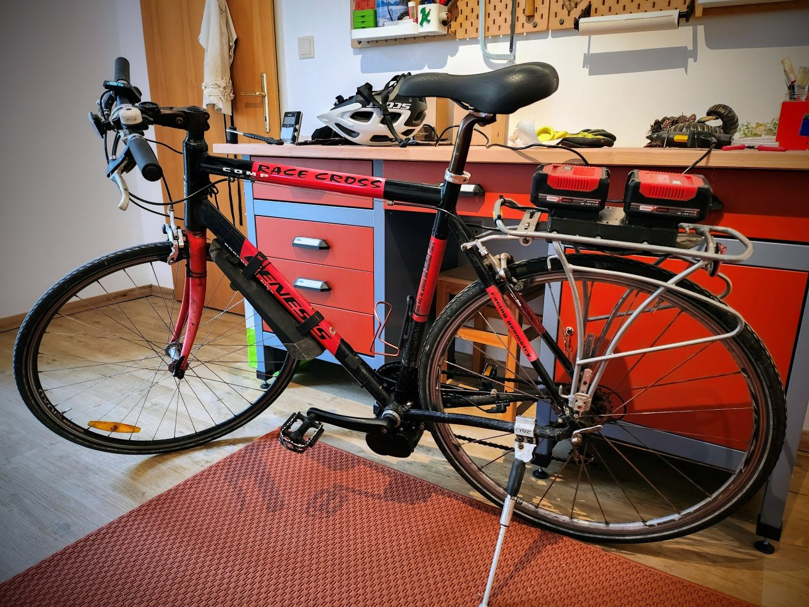

In 2022 my city bike, a Genesis Race Cross, needed a new chain. When changing it, I realized that I waited too long and the front transmission would need need replacement as well. When looking for replacement, I found [TDSZ2 motors](https://enerprof.de/products/freilauf-tongsheng-tsdz2b-36v-250w-mittelmotor-edition-2023) as possible replacements, turning the bike into a Pedelec that would be legal in the EU.

It comes with a display for the handlebar, so you only need to bring your own battery. I didn't want to buy a battery just for this and I would only use the bike for within the city, so I would be happy with 30-50km of range. I decided to re-use two 4Ah Einhell batteries that I already own for my power tools:

The batteries are 18V each (20V when fully charged), two in series are what the motor expects to see. I've designed and 3D printed the holder for the two batteries which goes on the rear rack.

The motor replaces the whole crank assembly (didn't take any pictures of the procedure). Finally, the only thing is to connect the supplied cables to the battery (I added a 20A fuse just in case) and the display:

By accident, the colors of batteries and bike match really well:

## Statistics

I built this bike in 2022. In November 2026 I did 4.000km with it, mostly shorter stop & go trips in the (flat) city. I mostly ride it in first or second of five modes and get 30km in winter and 50km range in summer. The batteries have their own BMS which makes sure they are not over- or undercharged and they stay in a comfortable temperature range. The batteries should have around 150 cycles on them now, I can't detect any degraded range as of yet.